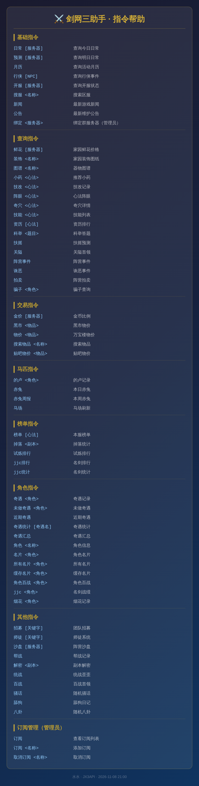

<div align="center">
  <a href="https://v2.nonebot.dev/store"></a>
  <br>
  <p></p>
</div>

<div align="center">

# nonebot-plugin-jx3

_基于 [NoneBot2](https://github.com/nonebot/nonebot2) 的剑网三（JX3）全功能现代化 QQ 群助手插件，支持全量游戏数据查询、权限分级自适应与 20+ 实时事件推送。_

<a href="./LICENSE">
    
</a>
<a href="https://pypi.python.org/pypi/nonebot-plugin-jx3">
    
</a>


</div>

## ✨ 核心特性与深度重构

本项目基于开源社区项目深度维护与现代化重构，全面对接官方最新规范并进行了全方位的特性增强：

- **官方 OpenAPI 规范对齐**：全面迁移并严格校验 [JX3API](https://www.jx3api.com) 最新规范，消除 404 失效接口，所有指令权限（免费、VIP 1、VIP 2）与鉴权规则 100% 吻合。
- **动态权限智能过滤**：
  - **`帮助` / `剑三帮助`**：自适应当前 `.env` 中的 Token 配置。未配置 Token 时，**完全不展示且静默忽略**付费指令，彻底杜绝无 Token 时频繁提示失败的不良体验；配置 Token 后自动展示 VIP 指令。
  - **`全部帮助`**：群管理员与超级用户专属指令，随时查看全量所有指令及权限等级标签。
- **推送体系与帮助完全解耦**：
  - 推送订阅与常规查询指令完全分离，普通帮助大图只展示查询与工具指令。
  - 发送 **`订阅`** 单独渲染**专属订阅管理高清图**，直观呈现当前群绑定的服务器、已生效推送事件标签、全部支持的事件清单以及单服/全服属性。
- **体验优化与链接交互**：
  - **`技改`**、**`新闻`**、**`公告`** 等包含官方更新链接的指令全面采用格式化文本直发，手机 QQ 内**可直接点击链接**跳转至官方公告。
  - **`小药`** 等字段无需冗余列标题的表格自动消除未翻译英文字段，界面更纯净直观。
- **高可用推送与抗风控链路**：
  - WebSocket 接收端支持断线指数退避自动重连（5s~60s）与心跳保活。
  - 推送发送端内置网络波动自动重试、外链风控降级过滤与群发频控队列，保障大群高并发推送稳定不封号。
- **Docker 容器化开箱即用**：内置独立 Dockerfile 与 docker-compose，构建期固化 Playwright Chromium 浏览器与系统字体，支持 TinyDB 数据目录本地挂载持久化。

---

## 快速导航

- [🐳 Docker 容器化部署（推荐）](#-docker-容器化部署与运维指南推荐)
- [⚙️ 配置项速查表](#-配置项速查表)
- [📖 指令与使用方法](#-指令与使用方法)
  - [基础管理](#1-群基础设置管理员)
  - [推送与订阅专属管理](#2-推送与事件订阅管理员)
  - [常用数据查询指令](#3-常用查询指令速查)
- [传统 Python 本地安装](#-传统-python-源码安装本地开发)
- [接口与权限说明](#-接口与权限说明)

---

## 🐳 Docker 容器化部署与运维指南（推荐）

本项目内置针对中国大陆网络加速的 Docker 容器化支持（Debian 阿里源、pip 阿里/腾讯源、Playwright 淘宝镜像），并在构建期**预装固化了 Playwright Chromium 内核**，杜绝运行期二次下载。

配合 **NapCat Docker** 即可实现零 Python 本地环境、纯开箱即用的一键部署。

### 1. 首次部署步骤

#### ① 准备配置文件
复制环境变量模版生成 `.env` 配置文件：
```bash
cp .env.example .env
```
修改关键参数：
- `SUPERUSERS`：机器人超级管理员 QQ 号列表，如 `SUPERUSERS=["10001"]`
- `JX3_DEFAULT_SERVER`：默认服务器名称，如 `绝代天骄`
- `JX3_BOT_NAME`：机器人昵称，如 `水水`
- `JX3_ENABLED_GROUPS`：允许响应的群白名单（留空 `[]` 则所有群均可使用）
- `JX3API_TOKEN`：JX3API 会员 Token（可选，按需配置以开启 VIP 指令）
- `JX3_TUILAN_TICKET`：推栏 Ticket（可选，JJC 战绩与配装必需）

#### ② 一键编译并后台启动
在项目根目录下执行：
```bash
docker compose up -d --build
```

#### ③ 登录 NapCat 并配置反向 WebSocket
1. 打开浏览器访问 NapCat WebUI 管理面板：
   ```text
   http://你的服务器IP或localhost:6099/webui
   ```
2. 手机 QQ 扫描面板二维码登录机器人账号。
3. 进入 **「网络配置」** 页面，新建或编辑一条 **「反向 WebSocket」**：
   - **名称**：`nonebot`（可自定义）
   - **URL / 地址**：`ws://bot:8080/onebot/v11/ws`
     *(由于处于同一 docker compose 网络，直接使用容器名 `bot` 即可内网直连)*
   - **重连间隔**：`3000` (毫秒)
   - **启用**：勾选开启，点击保存。
4. 在群中发送 `剑三帮助` 或 `日常`，机器人立即出图回复，部署成功！

---

### 2. 常用运维指令速查

| 操作场景 | 推荐命令 | 说明 |
|---|---|---|
| **修改代码后重新打包** | `docker compose up -d --build bot` | 仅重新编译 bot 镜像并平滑重建容器，不影响 NapCat 登录状态 |
| **全量重新编译并启动** | `docker compose up -d --build` | 编译并启动所有服务 |
| **修改 `.env` 后的重启** | `docker compose restart bot` | `.env` 已采用只读挂载，重启容器即可秒级生效 |
| **实时查看 Bot 运行日志** | `docker compose logs -f bot` | 查看收发消息、Matcher 匹配及报错栈 |
| **实时查看 NapCat 日志** | `docker compose logs -f napcat` | 查看 QQ 登录状态、心跳、网络连接日志 |
| **停止所有服务** | `docker compose stop` | 仅暂停容器，保留运行状态与数据 |
| **彻底停止并删除容器** | `docker compose down` | 移除容器网络（持久化目录 `./data` 和 `./napcat` 完整保留） |
| **进入 Bot 容器内部** | `docker compose exec bot bash` | 容器内手动调试环境 |

---

### 3. 数据持久化机制说明

项目采用宿主机本地数据卷挂载，所有业务与登录数据**完全脱离容器生命周期**：

- `./data:/app/data`：**Bot 核心业务数据目录**
  - `jx3_bind.json`：各群服务器绑定数据（记录群号与区服对应关系）。
  - `jx3_subscribe.json`：各群订阅事件列表（如奇遇、开服、抓马等推送规则）。
- `./.env:/app/.env:ro`：**全局配置文件**，外部修改后执行 `docker compose restart bot` 秒级生效。
- `./napcat/config` 与 `./napcat/qq`：**NapCat 登录凭证与配置**，扫码一次即可长久免扫码自动登录。

---

## ⚙️ 配置项速查表

在 `.env` 中按需配置：

| 配置项 | 默认值 | 说明 |
|---|---|---|
| `SUPERUSERS` | `["10001"]` | 超级管理员 QQ，不受群管限制，可在任意群进行绑定/订阅/查看全部帮助 |
| `COMMAND_START` | `["", "/"]` | 指令前缀，`""` 支持无前缀直接发词触发，如 `日常` |
| `JX3_DEFAULT_SERVER` | `绝代天骄` | 群未绑定服务器时的全局兜底区服 |
| `JX3_BOT_NAME` | `水水` | 渲染图片中显示的机器人昵称 |
| `JX3_ENABLED_GROUPS` | `[]` | 群白名单列表，`[]` 响应所有群；填入 `[123456]` 则仅白名单群可用 |
| `JX3API_BASE_URL` | `https://www.jx3api.com` | JX3API 官方 HTTP 数据接口 |
| `JX3_WSS_URL` | `wss://socket.nicemoe.cn` | JX3API 官方实时事件推送 WebSocket 节点 |
| `JX3API_TOKEN` | `""` | JX3API 会员 Token（未配置时自动隐藏并忽略 VIP 指令） |
| `JX3_TUILAN_TICKET` | `""` | 推栏 Ticket（名剑大会 JJC 战绩、推栏配装必需） |
| `JX3WSS_TOKEN` | `""` | 推送 Token（购买付费推送后填入） |
| `RENDER_STORAGE_PATH`| `/root/.cache/ms-playwright` | Playwright 浏览器固化缓存路径 |

---

## 📖 指令与使用方法

### 1. 群基础设置（管理员）

```text
绑定 <服务器名>        # 绑定本群默认服务器，例：绑定 绝代天骄
全部帮助               # 管理员专属，查看全量所有指令与权限等级清单
```

### 2. 推送与事件订阅（管理员）

推送事件已从普通帮助中独立，发送 **`订阅`** 即可在群内单独渲染**图文并茂的订阅管理大图**：

```text
订阅                  # 渲染本群订阅状态面板图（显示已生效推送与支持事件）
订阅 <事件名>          # 开启指定事件推送，例：订阅 开服
取消订阅 <事件名>      # 取消指定事件推送，例：取消订阅 818
```

#### 支持订阅的事件一览：

| 分类 | 事件名称 | 推送范围 | 功能说明 |
|---|---|---|---|
| **奇遇奇珍** | `奇遇` | 单服 | 绝世/普通奇遇触发全服实时广播播报 |
| | `绝世奇遇` | 单服 | 绝世奇遇触发全服公告特别播报 |
| | `扶摇` | 单服 | 扶摇九天开启即时提醒 |
| **马匹捕获** | `抓马` | 单服 | 马场龙子/麟驹/赤兔等高级马出世预告与捕获喜报 |
| | `的卢` | 单服 | 的卢出世、捕获与拍卖播报 |
| **阵营攻防** | `关隘` | 单服 | 烂柯山关隘首领冷却重置与挑战开启 |
| | `云丛` | 单服 | 云丛事件开启倒计时与事件预告 |
| | `攻防实况` | 单服 | 大小攻防战况、据点易手、首领击退战报 |
| | `阵营活动提醒` | 单服 | 周二周四阵营活动、战乱粮仓日常提醒 |
| | `诛恶` | 单服 | 恶人谷诛恶事件刷新全服广播 |
| | `阵营拍卖` | 单服 | 攻防拍卖极品装备通告 |
| **官方动态** | `开服` | 单服 | 本服维护完成开服极速通知 |
| | `新闻` | 全服 | 官方最新新闻资讯推送 |
| | `更新` | 全服 | 官方维护公告与补丁更新推送 |
| | `微博` | 全服 | 剑网3官方微博最新博文推送 |
| **社交八卦** | `818` / `八卦` | 全服 | 贴吧最新 818/吐槽/树洞精华速递 |
| | `玄晶` | 全服 | 全服大铁玄晶掉落通告 |
| | `烟花` | 全服 | 全服绝世烟花通告 |
| | `追魂` / `祭天` | 全服 | 全服追魂帖、祭天城管全服广播 |

> 📌 **提示**：标记为 **「单服」** 的事件需要本群先通过 `绑定 <服务器>` 绑定本群服务器；全服事件所有订阅群均可接收。

---

### 3. 常用查询指令速查

发送 **`帮助`** 或 **`剑三帮助`** 即可在群内实时获取最新的高清指令大图（自适应当前 Token 状态）：

<div align="center">
  
</div>

#### 指令分类概览：

- **基础与日常（免费）**：
  `日常`、`预测`、`月历`、`行侠`、`开服`、`搜服`、`新闻`、`公告`
- **角色与名片**：
  `角色` (VIP 1)、`面板` (VIP 2)、`装备详情` (VIP 2)、`装备记录` (VIP 2)、`查成就` (VIP 2)、`资历分布` (VIP 2)、`查发言` (VIP 2)、`名片` (VIP 2)、`所有名片` (VIP 2)、`随机名片` (VIP 2)、`角色百战` (VIP 2)、`我的百战` (VIP 2)、`jjc` (VIP 1)、`烟花` (VIP 2)
- **武学与心法**：
  `小药` (免费)、`技改` (免费，文本直发带链接)、`配装` (VIP 2)、`阵眼` (VIP 1)、`奇穴` (VIP 1)、`技能` (VIP 1)、`急速` (VIP 2)、`资历` (VIP 1)
- **奇遇与奇珍 (VIP 1)**：
  `奇遇`、`未做奇遇`、`近期奇遇`、`奇遇统计`、`奇遇汇总`、`奇遇攻略`
- **交易与经济**：
  `金价` (VIP 1)、`黑市` (VIP 1)、`物价` (VIP 1)、`搜索物品` (VIP 1)、`贴吧物价` (VIP 1)、`成本计算` (VIP 2)、`万宝楼查号` (VIP 2)
- **马匹与捕获**：
  `的卢` (VIP 2)、`赤兔` (VIP 2)、`赤兔周报` (VIP 2)、`马场` (VIP 1)、`抓马倒计时` (VIP 2)
- **沙盘与阵营**：
  `沙盘` (VIP 1)、`帮战` (免费)、`统战` (免费)、`关隘` (VIP 2)、`关隘状态` (VIP 2)、`诛恶` (VIP 2)、`诛恶历史` (VIP 2)、`拍卖` (VIP 2)
- **秘境与排行榜**：
  `百战` (VIP 2)、`百战周报` (VIP 2)、`解密` (VIP 1)、`秘境方位` (VIP 1)、`掉落` (VIP 1)、`榜单` (VIP 1)、`名剑总榜` (VIP 2)、`争霸榜` (VIP 2)、`捕快榜` (VIP 2)、`浪客榜` (VIP 2)、`决斗榜` (VIP 2)、`排行统计` (VIP 1)、`试炼排行` (VIP 1)、`试炼秒伤` (VIP 1)、`试炼赛季` (VIP 1)、`jjc排行` (VIP 1)、`jjc统计` (VIP 1)
- **生活与娱乐（免费/趣味）**：
  `鲜花`、`装饰`、`图谱`、`科举`、`扶摇`、`招募` (VIP 1)、`师徒` (VIP 1)、`骗子` (VIP 1)、`骚话`、`舔狗`、`吃什么`、`喝什么`、`答案之书`、`渣男`、`八卦` (VIP 1)、`语录` (VIP 2)

---

## 💻 传统 Python 源码安装（本地开发）

如果你需要在本地直接以 Python 模式开发或集成到现有 NoneBot 实例：

```bash
nb plugin install nonebot-plugin-jx3
# 或
pip install nonebot-plugin-jx3
```

**运行依赖**：`nonebot2[fastapi]>=2.0.0`、`nonebot-adapter-onebot>=2.0.0`、`nonebot-plugin-apscheduler>=0.3.0`、`nonebot-plugin-htmlrender>=0.2.0,<0.8.0`、`playwright>=1.26.0`、`tinydb>=4.5.1`

本地环境需预先运行安装浏览器内核：
```bash
python -m playwright install --with-deps chromium
```

---

## 🔒 接口与权限说明

- **免费接口（Level 0）**：无需任何 Token 即可直接使用（日常、开服、技改、小药、金价、科举、搜服、娱乐语录等）。
- **VIP 接口（Level 1 / Level 2）**：需在 `.env` 中填写 `JX3API_TOKEN`（购买地址：[jx3api.com](https://www.jx3api.com)）。未配置 Token 时，插件会自动隐藏收费接口且静默忽略，绝无报错骚扰。
- **JJC / 配装特权**：名剑大会详细战绩与推栏推荐配装额外需要配置 `JX3_TUILAN_TICKET`。
- **实时推送功能**：基础广播无需额外配置；付费实时推送功能需配置 `JX3WSS_TOKEN`，WebSocket 支持断线指数退避自动重连（5s~60s）与抗风控降级。

---

## 致谢与声明

- 本项目基于开源社区 [nonebot-plugin-jx3](https://github.com/fuyang0811/nonebot-plugin-jx3) 项目二次开发并深度维护优化。
- 数据接口由 [JX3API](https://www.jx3api.com) 提供支持。
- 感谢开源社区所有贡献者与资源提供方。
